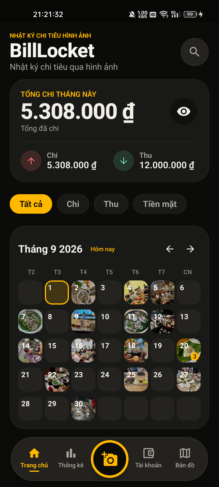
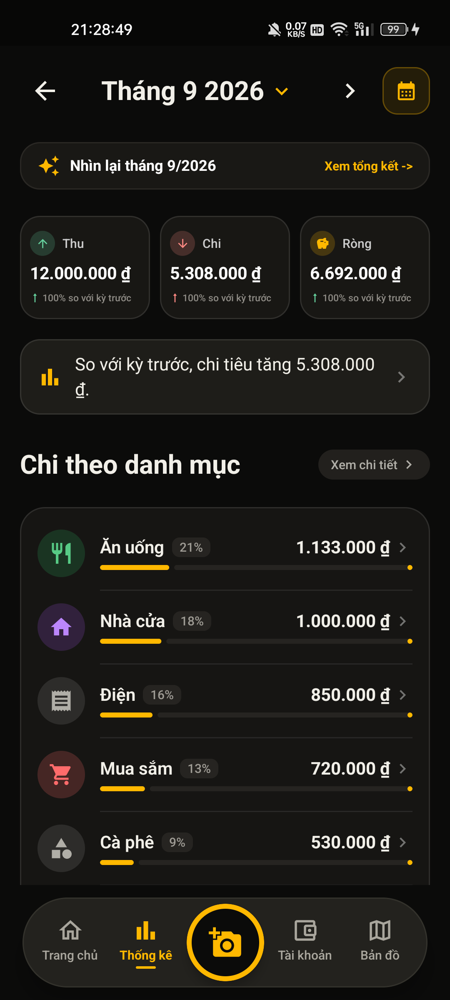
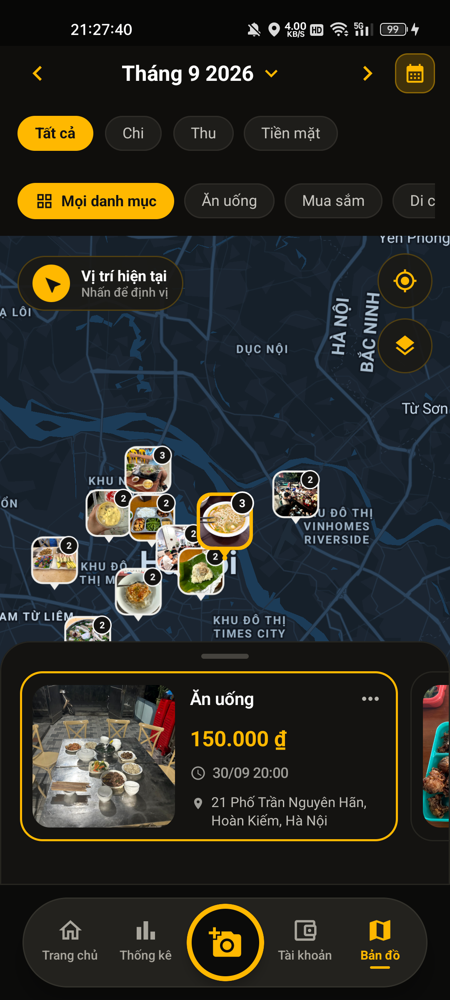
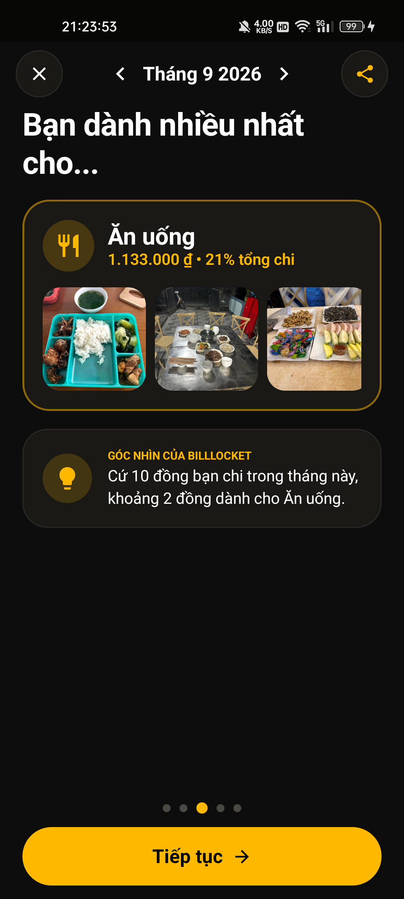
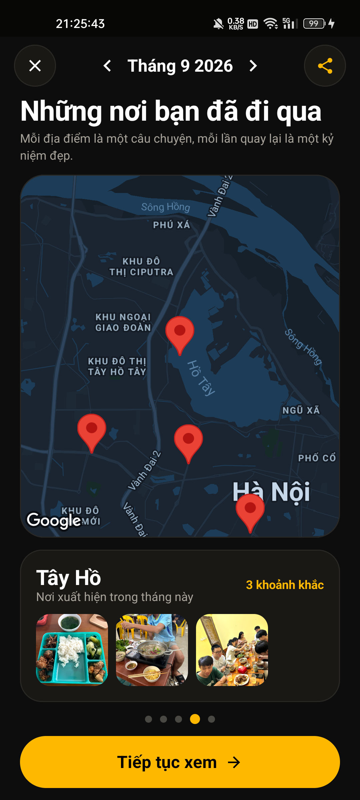
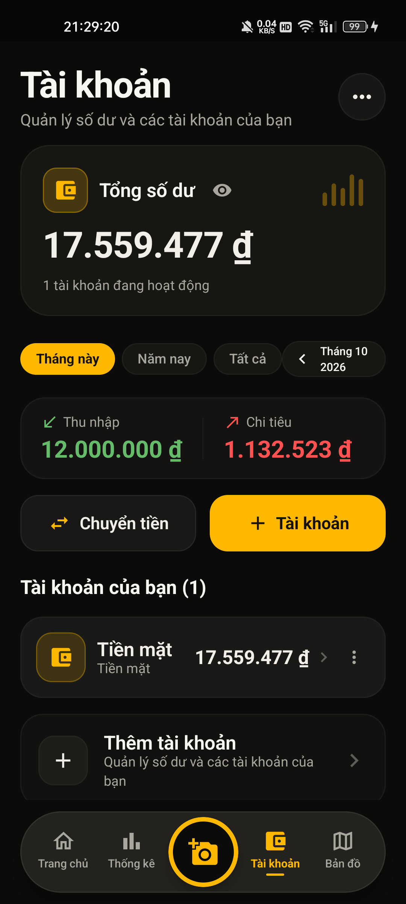
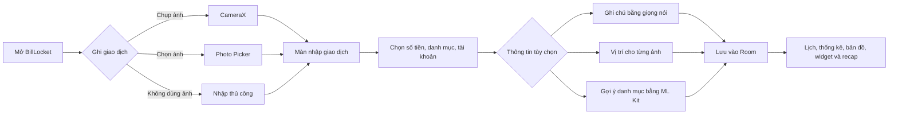
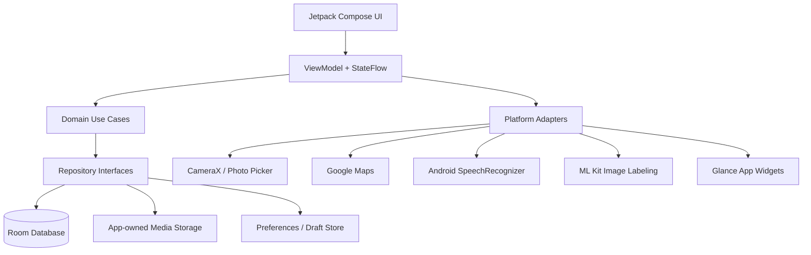

# BillLocket

<div align="center">
  

  **Nhật ký tài chính riêng tư, trực quan và giàu ký ức trên Android**

  Ghi lại thu chi bằng ảnh, xem lại theo lịch và địa điểm, theo dõi tài chính mà không cần tài khoản hay máy chủ trung gian.

  
  
  
  
  
</div>

---

## Mục lục

- [Giới thiệu](#giới-thiệu)
- [Trải nghiệm UI/UX](#trải-nghiệm-uiux)
- [Tính năng chính](#tính-năng-chính)
- [Luồng sử dụng](#luồng-sử-dụng)
- [Kiến trúc và công nghệ](#kiến-trúc-và-công-nghệ)
- [Cài đặt và chạy dự án](#cài-đặt-và-chạy-dự-án)
- [Cấu hình Google Maps](#cấu-hình-google-maps)
- [Kiểm thử và đóng gói](#kiểm-thử-và-đóng-gói)
- [Quyền riêng tư và quyền hệ thống](#quyền-riêng-tư-và-quyền-hệ-thống)
- [Cấu trúc mã nguồn](#cấu-trúc-mã-nguồn)
- [Tài liệu dự án](#tài-liệu-dự-án)

## Giới thiệu

**BillLocket** là ứng dụng quản lý tài chính cá nhân theo hướng *photo-first*: mỗi giao dịch không chỉ là một con số mà còn có thể gắn với ảnh, thời gian và địa điểm của khoảnh khắc đó.

Ứng dụng tập trung vào ba mục tiêu:

1. **Ghi chép nhanh:** chụp hoặc chọn ảnh, nhập số tiền và lưu giao dịch trong một luồng ngắn.
2. **Xem lại trực quan:** lịch ảnh, bản đồ ảnh và tổng kết tháng giúp lịch sử chi tiêu dễ nhớ hơn danh sách thuần văn bản.
3. **Riêng tư mặc định:** dữ liệu tài chính được lưu cục bộ bằng Room, không yêu cầu đăng nhập và không phụ thuộc backend để sử dụng các chức năng cốt lõi.

### Điểm nổi bật

| Nhóm | Khả năng |
| --- | --- |
| Giao dịch | Tạo, sửa, tìm kiếm, xóa/hoàn tác; hỗ trợ giao dịch có hoặc không có ảnh |
| Hình ảnh | CameraX, Photo Picker, nhiều ảnh trên một giao dịch, thư viện ký ức theo ngày |
| Tài chính | Thu/chi, tài khoản, danh mục, chuyển tiền, ngân sách và cảnh báo |
| Phân tích | Tổng quan tháng, thống kê theo danh mục, so sánh kỳ và Monthly Recap |
| Vị trí | Gắn vị trí tùy chọn cho từng ảnh, chọn thủ công và xem trên Google Maps |
| Tiện ích | Widget giao dịch gần nhất, tổng kết hôm nay và tổng kết tuần |
| Hỗ trợ thông minh | Nhập ghi chú bằng giọng nói và gợi ý danh mục ảnh bằng ML Kit trên thiết bị |
| Dữ liệu | Sao lưu/khôi phục cục bộ, bản xuất đầy đủ hoặc riêng tư |
| Ngôn ngữ | Tiếng Việt, English và chế độ theo ngôn ngữ hệ thống |

## Trải nghiệm UI/UX

BillLocket sử dụng giao diện tối, điểm nhấn vàng và màu ngữ nghĩa rõ ràng: đỏ san hô cho khoản chi, xanh bạc hà cho khoản thu. Thanh điều hướng đặt thao tác ghi giao dịch ở trung tâm để luôn truy cập được bằng một lần chạm.

> Các ảnh bên dưới được chụp trực tiếp trên **Realme RMX3370 chạy Android 13**, sử dụng dữ liệu demo tháng 9. Thông tin tài chính và ảnh chỉ nhằm minh họa giao diện.

<table>
  <tr>
    <td align="center"><strong>Lịch ảnh và tổng quan tháng</strong></td>
    <td align="center"><strong>Thống kê chi tiêu</strong></td>
    <td align="center"><strong>Bản đồ giao dịch</strong></td>
  </tr>
  <tr>
    <td></td>
    <td></td>
    <td></td>
  </tr>
  <tr>
    <td align="center"><strong>Góc nhìn danh mục</strong></td>
    <td align="center"><strong>Những nơi đã đi qua</strong></td>
    <td align="center"><strong>Quản lý tài khoản</strong></td>
  </tr>
  <tr>
    <td></td>
    <td></td>
    <td></td>
  </tr>
</table>

### Nguyên tắc thiết kế

- **Photo-first nhưng không bắt buộc ảnh:** giao dịch thủ công vẫn hoạt động đầy đủ khi không cấp quyền camera hoặc vị trí.
- **Một tay, ít bước:** nút chụp nằm ở trung tâm; các trường quan trọng được ưu tiên trong màn nhập giao dịch.
- **Phản hồi tức thời:** trạng thái lấy vị trí, phân tích ảnh và nhận dạng giọng nói được hiển thị riêng, không khóa luồng nhập liệu.
- **Kiểm soát thuộc về người dùng:** AI chỉ gợi ý; ứng dụng không tự lưu hoặc tự ghi đè dữ liệu tài chính.
- **Khả năng phục hồi:** bản nháp, thao tác xóa có hoàn tác và quy trình sao lưu giúp giảm rủi ro mất dữ liệu.

## Tính năng chính

### 1. Ghi giao dịch bằng ảnh

- Chụp ảnh trực tiếp bằng CameraX hoặc nhập nhiều ảnh bằng Android Photo Picker.
- Hỗ trợ bỏ qua ảnh để nhập giao dịch tài chính thông thường.
- Chọn loại giao dịch, danh mục, tài khoản, ngày giờ và ghi chú.
- Lưu nhiều ảnh theo thứ tự; mỗi ảnh có thể mang vị trí riêng.
- Chuẩn hóa ảnh vào vùng lưu trữ do ứng dụng quản lý và loại bỏ metadata nhạy cảm không cần thiết.

### 2. Lịch ký ức tài chính

- Tổng hợp thu, chi theo tháng.
- Hiển thị ảnh đại diện trực tiếp trên từng ngày của lịch.
- Chạm ngày có ảnh để mở trình xem ký ức toàn màn hình.
- Lọc theo loại giao dịch và tài khoản; tìm kiếm theo nội dung liên quan.

### 3. Thống kê và ngân sách

- Theo dõi tổng thu, tổng chi và dòng tiền ròng.
- Phân tích chi tiêu theo danh mục và so sánh với kỳ trước.
- Tạo ngân sách tháng và nhận cảnh báo theo ngưỡng.
- Số tiền được lưu dưới dạng số nguyên để tránh sai số dấu phẩy động.

### 4. Bản đồ ảnh giao dịch

- Hiển thị ảnh đã xác nhận vị trí dưới dạng marker trên Google Maps.
- Gom nhóm các ảnh gần nhau và hiển thị số lượng ngay trên marker.
- Lọc theo tháng, loại giao dịch, tài khoản và danh mục.
- Xem nhanh ảnh, số tiền, thời gian và địa chỉ từ carousel trên bản đồ.
- Bản đồ hoặc mạng gặp lỗi không làm mất quyền truy cập dữ liệu tài chính cục bộ.

### 5. Monthly Recap

- Kể lại tháng bằng chuỗi trang trực quan gồm ảnh, số liệu, danh mục và địa điểm.
- Hiển thị ngày hoạt động nổi bật, danh mục chi tiêu nhiều nhất và các nơi thường ghé.
- Cho phép chọn mức thông tin trước khi tạo ảnh chia sẻ.
- Có thể ẩn số tiền, ghi chú hoặc vị trí để tạo bản xuất riêng tư hơn.

### 6. Giọng nói và gợi ý ảnh

- Dùng Android `SpeechRecognizer` để nhập ghi chú bằng tiếng Việt hoặc tiếng Anh.
- Hiển thị trạng thái bắt đầu, đang nghe, phát hiện âm thanh và xử lý.
- Dùng ML Kit Image Labeling trên thiết bị để đưa ra gợi ý danh mục có độ tin cậy phù hợp.
- Không lưu buffer âm thanh và không tự động áp dụng gợi ý vào giao dịch.

### 7. Widget và sao lưu

- Ba widget chính: giao dịch gần nhất, tổng kết hôm nay và tổng kết tuần.
- Xuất bản sao lưu đầy đủ hoặc bản riêng tư không chứa ảnh/vị trí.
- Kiểm tra cấu trúc và tính toàn vẹn trước khi khôi phục dữ liệu.

## Luồng sử dụng



Các tiện ích vị trí, giọng nói, bản đồ và phân tích ảnh đều là **tùy chọn**. Nếu một tiện ích không sẵn sàng, người dùng vẫn có thể nhập và lưu giao dịch thủ công.

## Kiến trúc và công nghệ

### Kiến trúc tổng thể



Mã nguồn được tổ chức theo hướng phân lớp:

- **Presentation:** Compose, Navigation, ViewModel, `StateFlow<State>`, Action và Effect.
- **Domain:** model, quy tắc nghiệp vụ, validator, use case và repository interface thuần Kotlin.
- **Data:** Room DAO/entity, repository implementation, backup và lưu trữ media.
- **Platform:** camera, vị trí, bản đồ, giọng nói, widget, thông báo và chia sẻ tệp.
- **Dependency injection:** Hilt cung cấp implementation qua các module có phạm vi rõ ràng.

### Công nghệ sử dụng

| Thành phần | Công nghệ |
| --- | --- |
| Ngôn ngữ | Kotlin 2.0.21 |
| Giao diện | Jetpack Compose, Material 3 |
| Kiến trúc UI | Single Activity, Navigation Compose, MVVM/UDF |
| Bất đồng bộ | Kotlin Coroutines, Flow, StateFlow |
| Cơ sở dữ liệu | Room 2.7.1, KSP |
| Dependency Injection | Hilt 2.51.1 |
| Camera và ảnh | CameraX 1.4.2, Photo Picker, Coil 3.0.4, ExifInterface |
| Bản đồ | Google Maps Compose 6.1.2 |
| AI trên thiết bị | ML Kit Image Labeling 17.0.9 |
| Nhận dạng giọng nói | Android SpeechRecognizer |
| Widget | Jetpack Glance 1.1.1 |
| Công việc nền | WorkManager 2.10.2 |
| Build | Gradle 8.11.1, AGP 8.9.0, JDK 17 |

## Cài đặt và chạy dự án

### Yêu cầu môi trường

- Windows, macOS hoặc Linux có Android Studio.
- **JDK 17** dùng để chạy Gradle.
- Android SDK Platform **35** và Build Tools **35.0.0**.
- Thiết bị hoặc emulator Android **8.0 / API 26** trở lên.
- Git để tải mã nguồn.

### 1. Tải dự án

```bash
git clone https://github.com/suThyyy/BillLocket.git
cd BillLocket
```

### 2. Mở bằng Android Studio

1. Chọn **Open** và mở thư mục `BillLocket`.
2. Chờ Gradle Sync hoàn tất.
3. Kiểm tra Android Studio đang dùng JDK 17 tại:
   `Settings > Build, Execution, Deployment > Build Tools > Gradle > Gradle JDK`.
4. Chọn thiết bị Android API 26+.
5. Bấm **Run** để chạy cấu hình `app`.

### 3. Build bằng PowerShell

Tại thư mục gốc của repository:

```powershell
$env:JAVA_HOME = 'C:/Program Files/Java/jdk-17'
$env:ANDROID_HOME = "$env:LOCALAPPDATA/Android/Sdk"

.\gradlew.bat assembleDebug
```

APK debug được tạo tại:

```text
app/build/outputs/apk/debug/app-debug.apk
```

Nếu Android SDK không được cung cấp qua `ANDROID_HOME`, Android Studio có thể tạo `local.properties`:

```properties
sdk.dir=C\:\\Users\\<TEN_NGUOI_DUNG>\\AppData\\Local\\Android\\Sdk
```

Không commit `local.properties`, khóa bản đồ, khóa ký APK hoặc thông tin riêng tư lên Git.

## Cấu hình Google Maps

Ứng dụng vẫn build và các chức năng tài chính vẫn hoạt động khi chưa có khóa Maps. Để hiển thị bản đồ nền:

1. Tạo hoặc chọn một project trong Google Cloud Console.
2. Bật thanh toán cho project theo yêu cầu của Google Maps Platform.
3. Bật **Maps SDK for Android**.
4. Tạo API key và giới hạn key theo:
   - Application ID: `com.billlocket.app`;
   - SHA-1 của certificate debug/release cần sử dụng;
   - Chỉ Maps SDK for Android, trừ khi một API khác được phê duyệt riêng.
5. Tạo file `secrets.properties` ở thư mục gốc:

```properties
MAPS_API_KEY=YOUR_ANDROID_RESTRICTED_MAPS_KEY
```

File `secrets.properties` đã được ignore. Repository chỉ theo dõi `local.defaults.properties` với giá trị trống để bản clone sạch vẫn có thể build.

Lấy SHA-1 của debug certificate:

```powershell
.\gradlew.bat signingReport
```

## Kiểm thử và đóng gói

### Bộ lệnh kiểm tra đầy đủ

```powershell
# Unit tests
.\gradlew.bat test

# APK debug và APK instrumentation test
.\gradlew.bat assembleDebug
.\gradlew.bat assembleDebugAndroidTest

# APK release
.\gradlew.bat assembleRelease

# Android Lint và định dạng
.\gradlew.bat lint
.\gradlew.bat spotlessCheck

# Kiểm tra whitespace của thay đổi Git
git diff --check
```

`spotlessApply` có thể sửa mã nguồn, vì vậy chỉ chạy khi chủ động định dạng và sẽ review toàn bộ diff:

```powershell
.\gradlew.bat spotlessApply
```

### Kiểm thử trên thiết bị

Các luồng nên được kiểm tra thủ công trên máy thật:

- chụp/chọn ảnh và tạo giao dịch có hoặc không có vị trí;
- từ chối từng quyền mà không làm hỏng nhập liệu thủ công;
- ghi chú bằng tiếng Việt và tiếng Anh;
- lịch ảnh, trình xem ký ức, bản đồ và Monthly Recap;
- widget sau khi thêm/sửa/xóa giao dịch;
- export/import bản sao lưu;
- light/dark theme, cỡ chữ lớn và TalkBack.

## Quyền riêng tư và quyền hệ thống

| Quyền | Mục đích | Khi từ chối |
| --- | --- | --- |
| Camera | Chụp ảnh giao dịch | Vẫn chọn ảnh hoặc nhập giao dịch không ảnh |
| Vị trí chính xác/gần đúng | Gắn vị trí tùy chọn cho ảnh | Giao dịch vẫn lưu; có thể chọn vị trí thủ công sau |
| Microphone | Nhập ghi chú bằng giọng nói | Vẫn nhập bằng bàn phím |
| Thông báo | Cảnh báo ngân sách | Theo dõi ngân sách vẫn hoạt động trong ứng dụng |
| Internet | Tải bản đồ nền và dịch vụ speech dự phòng | Dữ liệu tài chính cục bộ vẫn truy cập được |

Cam kết dữ liệu:

- Không cần tạo tài khoản người dùng.
- Room là nguồn dữ liệu tài chính cục bộ chính.
- BillLocket không lưu buffer âm thanh microphone.
- Ảnh được lưu trong vùng do ứng dụng quản lý; Room chỉ lưu URI và metadata.
- Vị trí thuộc từng ảnh và chỉ xuất hiện trên bản đồ sau khi có tọa độ hợp lệ.
- Android Auto Backup bị tắt; người dùng chủ động xuất/nhập bản sao lưu.
- API key, ảnh biên lai cá nhân, log thiết bị và file backup không được đưa vào repository.

## Cấu trúc mã nguồn

```text
BillLocket/
├── app/
│   ├── schemas/                  # Room schema JSON
│   └── src/
│       ├── main/
│       │   ├── java/com/billlocket/app/
│       │   │   ├── data/         # Room, repository implementation, backup
│       │   │   ├── di/           # Hilt modules
│       │   │   ├── domain/       # Model, use case, validation, contracts
│       │   │   ├── feature/      # Home, capture, editor, map, recap...
│       │   │   ├── locale/       # Ngôn ngữ và formatter
│       │   │   ├── media/        # Media store/provider
│       │   │   ├── navigation/   # Navigation Compose destinations
│       │   │   ├── ui/           # Theme và thành phần dùng chung
│       │   │   └── widget/       # Glance widgets
│       │   └── res/              # String, icon, XML, theme
│       ├── test/                  # JVM unit tests
│       └── androidTest/           # Instrumentation tests
├── docs/
│   ├── assets/readme/            # Ảnh demo trong README
│   └── *.md                       # Đặc tả và quyết định kỹ thuật
├── gradle/                        # Wrapper và version catalog
├── local.defaults.properties      # Giá trị Maps an toàn mặc định
└── README.md
```

## Tài liệu dự án

| Tài liệu | Nội dung |
| --- | --- |
| [Tầm nhìn sản phẩm](docs/00-VISION.md) | Vấn đề, người dùng mục tiêu và nguyên tắc sản phẩm |
| [Yêu cầu V1](docs/01-REQUIREMENTS.md) | Phạm vi chức năng và tiêu chí chấp nhận |
| [Kiến trúc](docs/03-ARCHITECTURE.md) | Ranh giới presentation, domain, data và platform |
| [Thiết kế cơ sở dữ liệu](docs/04-DATABASE.md) | Room schema, quan hệ, index và migration |
| [Quy tắc nghiệp vụ](docs/05-BUSINESS-RULES.md) | Quy tắc tiền, giao dịch, chuyển khoản và ngân sách |
| [Repository và use case](docs/06-REPOSITORIES-USE-CASES.md) | Hợp đồng dữ liệu và trách nhiệm các lớp |
| [Google Maps](docs/07-MAP-PROVIDER.md) | Quyết định nhà cung cấp và cách bảo vệ API key |
| [Media và backup](docs/08-MEDIA-STORAGE-BACKUP.md) | Lưu ảnh, cleanup, export và restore |
| [Đặc tả hiện tại](docs/15-CURRENT-PRODUCT-SPEC-AND-ROADMAP.md) | Trạng thái sản phẩm và roadmap |
| [Voice, localization và AI](docs/16-VOICE-LOCALIZATION-AI-PLAN.md) | Thiết kế các tiện ích hỗ trợ thông minh |
| [Kế hoạch ổn định demo](docs/17-DEMO-STABILIZATION-PLAN.md) | Tiêu chí ổn định và kiểm thử thiết bị |
| [Sổ tay bảo vệ đồ án](docs/BILLOCKET-DEFENSE-HANDBOOK.md) | Tra cứu nhanh kiến trúc, tính năng và câu hỏi vấn đáp |
| [Architecture Decisions](docs/DECISIONS.md) | Các ADR quan trọng của dự án |
| [Tính năng tương lai](docs/FUTURE_FEATURES.md) | Ý tưởng chưa thuộc phạm vi V1 |

## Trạng thái và giới hạn hiện tại

- Bản đồ nền cần Google Maps API key hợp lệ, billing và kết nối mạng.
- Chất lượng nhận dạng giọng nói phụ thuộc speech service của thiết bị; một số máy có thể cần mạng hoặc gói ngôn ngữ.
- Gợi ý danh mục từ ảnh là hỗ trợ có kiểm soát, không phải nhận diện biên lai hoàn chỉnh.
- V1 chưa có đồng bộ đám mây, chia sẻ sổ chung hoặc nhập tự động từ ngân hàng.
- Dữ liệu demo và kết quả AI không nên được xem là tư vấn tài chính.

## Nguồn gốc kỹ thuật

BillLocket sử dụng nhánh `develop` của [`luucaohoanq/nocket-compose`](https://github.com/luucaohoanq/nocket-compose) làm điểm khởi đầu kỹ thuật với sự cho phép của tác giả. Dự án đã loại bỏ backend, xác thực và hành vi mạng xã hội kế thừa, sau đó xây dựng lại theo kiến trúc nhật ký tài chính offline-first của BillLocket.

Các file trong `Sources/assets/` chỉ được giữ làm bằng chứng lịch sử của mã nguồn nền; chúng không phải ảnh giao diện BillLocket và không được sử dụng làm tài sản sản phẩm.

---

<div align="center">
  <strong>BillLocket — Ghi lại con số, giữ lại khoảnh khắc.</strong>
</div>
